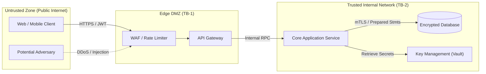

# Threat Model: [SYSTEM_OR_FEATURE_NAME]

- **Analysis Date**: [YYYY-MM-DD]
- **Analyst(s)**: [Security Analyst / Agent]
- **Target Scope**: [Repository / Subsystem / Public API / Auth Module]
- **Methodology**: STRIDE-A (STRIDE + Abuse Cases) & Zero Trust Principles
- **Canonical Path**: `docs/security/threat-model-[system-slug].md`

---

## 1. System Scope & Architecture Overview

### Target Assets & Trust Boundaries
- **High-Value Assets**: User credentials, session tokens, customer payment data, API keys.
- **Trust Boundaries**:
  - `TB-1`: Public Internet $\longleftrightarrow$ API Gateway / Edge Router.
  - `TB-2`: Application Service $\longleftrightarrow$ Database & Internal Cache.
  - `TB-3`: Application Service $\longleftrightarrow$ Third-Party Webhooks (Stripe, GitHub).

### Data Flow Diagram (DFD Level 1)

---

## 2. STRIDE-A Threat Analysis

| Threat ID | Category | Component Affected | Threat Description | Severity (CVSS) | Proposed Mitigation / Control | Status |
|---|---|---|---|---|---|---|
| `THR-001` | **S**poofing | API Gateway | Attacker forges JWT token using weak signature key | High | Use asymmetric RS256/EdDSA, enforce key rotation and strict issuer validation | Mitigated |
| `THR-002` | **T**ampering | Order Checkout | Client modifies order payload `total_amount` before submit | High | Recompute prices server-side; ignore client-provided pricing fields | Mitigated |
| `THR-003` | **R**epudiation | Billing Admin | Admin refunds transactions without audit log | Medium | Append-only immutable audit log in separate logging account | Planned |
| `THR-004` | **I**nfo Disclosure | Error Responses | Stack trace and internal DB schema leaked in HTTP 500 | Medium | Global exception filter masks internal details; log full trace internally | Mitigated |
| `THR-005` | **D**enial of Service | Search Endpoint | Complex regex or unindexed query exhausts CPU | High | Strict rate limiting, query timeouts (2s), parameterized pagination | Mitigated |
| `THR-006` | **E**levation of Priv | User Profile | IDOR: User updates `role=admin` via PUT `/api/users/me` | Critical | Enforce strict DTO allowlists; prevent binding of privileged fields | Mitigated |
| `THR-007` | **A**buse Cases | Account Creation | Sybil attack creating 10,000 dummy accounts for free credits | Medium | Implement bot detection (Turnstile/reCAPTCHA) and credit card verification | Open |

---

## 3. Prioritized Remediation Roadmap

1. **Immediate P0 / Critical**: Fix IDOR vulnerability on user role binding (`THR-006`).
2. **P1 / High**: Implement asymmetric JWT validation and rate limiting on search endpoint (`THR-001`, `THR-005`).
3. **P2 / Medium**: Enable immutable audit trail and bot defenses (`THR-003`, `THR-007`).

---

## 4. Verification & Testing Evidence
- [ ] Automated security scan run (e.g. Snyk / Semgrep / Trivy): [0 critical, 0 high vulnerabilities].
- [ ] Penetration testing / abuse case simulated for all Mitigated threats.

